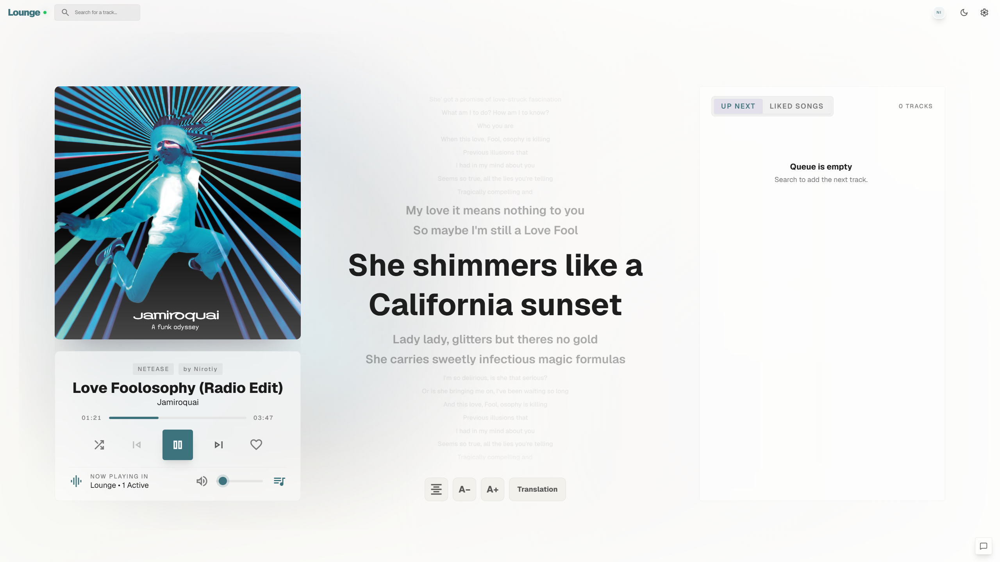
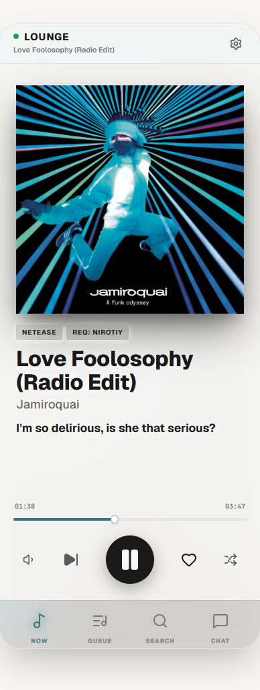

# MusicParty NRT

> 一个面向自托管场景的多人实时听歌房间。搜索、点歌、同步播放、歌词、队列、聊天和房间管理都在同一个 Web 应用中完成。

[](https://github.com/BigBlackBlob/MusicParty/actions/workflows/ci.yml)


MusicParty NRT 是基于上游 MusicParty 持续演进的个人 fork。当前主线已经完成 Go-only 重构：Go 后端是唯一运行时，Vue 前端通过生成契约连接 HTTP 与 WebSocket，SQLite 保存账号、房间和播放数据，Docker 镜像同时发布到 GHCR 与阿里云 ACR。

## 界面预览





## 能做什么

- **多人同步播放**：房间级 WebSocket 运行时维护权威播放快照、队列版本、在线成员和服务端时间锚点；断线、页面恢复和版本间隙会触发 resync。
- **多房间与访问控制**：支持公开房间、私有房间、房主权限、平台管理员权限和房间级访问 Cookie。
- **访客、邀请与管理员入口**：访客可快速进入；邀请码用于建立持久成员身份；本地平台管理员使用账号密码登录。
- **协作队列**：支持点歌、拖拽重排、置顶、批量操作、ACK/NACK 回滚和防止单用户占满队列的限制。
- **音乐平台**：支持网易云、Bilibili、YouTube、SoundCloud、本地媒体以及多个 Subsonic/Navidrome 源。搜索支持直接解析歌曲链接：YouTube 的 `watch?v=`、`youtu.be/`、`/embed/`、`/shorts/` 以及 `m.youtube.com`、`music.youtube.com` 链接；Bilibili 的 `www.bilibili.com/video/BV…`；网易云的 `music.163.com/#/song?id=…`、`music.163.com/song?id=…` 和 `y.music.163.com/m/song?id=…`；以及 SoundCloud 完整永久链接。也可通过关键词搜索。第三方平台是否可用取决于对应服务和凭据状态。
- **歌词**：网易云歌词、翻译歌词、自动滚动、字号和对齐调节在桌面端与移动端共用同一套歌词状态。
- **歌单与喜欢歌曲**：支持个人歌单、房间歌单、喜欢歌曲、外部歌单导入以及队列批量加入。
- **实时聊天与成员状态**：房间聊天、公共聊天、系统事件、在线成员和未读状态相互隔离并实时更新。
- **本地媒体库**：授权用户可以上传音频；后端负责元数据、封面、转码、缓存和代理播放。选择文件后会自动读取 ID3 标签并预填标题、艺人和专辑信息，可在上传前编辑。逐文件队列展示真实 XHR 字节上传进度和排队中、上传中、完成或失败状态；失败文件保留以便重试，最多同时上传两个文件。
- **桌面自由布局**：Now Playing、歌词、队列、聊天、成员和房间歌单等模块可自由组合、拖拽并保存布局。
- **移动端与 Lite Mode**：独立移动端 shell、底部导航、完整播放页和轻量模式共享相同领域状态。
- **中英文与无障碍**：主要流程支持中英文、键盘焦点、按钮语义和可访问名称。

## 访问模型

MusicParty 使用后端签发的 HttpOnly Cookie，不把认证 token 暴露给浏览器脚本。

| 身份 | 典型能力 |
| --- | --- |
| 访客 | 进入允许的房间、听歌、点歌和聊天 |
| 邀请成员 | 持久身份、个人歌单、喜欢歌曲和受授权的私有音源 |
| 房主 | 管理当前房间、密码、成员、邀请和房间歌单 |
| 平台管理员 | 管理站点平台凭据、媒体源、上传权限和所有房间 |

首次启动通过 `BOOTSTRAP_ADMIN_USERNAME` 与 `BOOTSTRAP_ADMIN_PASSWORD` 建立平台管理员。邀请码可以在设置中心的房间管理区域创建和撤销。

## Docker 快速部署

### 1. 准备配置

```bash
git clone -b NRT-Base https://github.com/BigBlackBlob/MusicParty.git
cd MusicParty
cp .env.example .env
```

至少设置以下内容：

```dotenv
MUSIC_PARTY_IMAGE=ghcr.io/bigblackblob/musicparty@sha256:<immutable-digest>
NETEASE_API_IMAGE=moefurina/ncm-api:4.41.1@sha256:2fcf4dc49313109a91f6cec99c6b36ebd17e8f1fdc89686121dfd14525937896
BASE_URL=https://music.example.com
ALLOWED_ORIGINS=https://music.example.com
BOOTSTRAP_ADMIN_USERNAME=admin
BOOTSTRAP_ADMIN_PASSWORD=replace-with-a-strong-password
```

生产环境必须使用 GitHub Actions 摘要中的不可变 digest。`nrt-base` 是滚动标签，只适合临时验证。

如果服务器访问 GHCR 不稳定，可以使用同一次构建发布到阿里云 ACR 的相同镜像：

```dotenv
MUSIC_PARTY_IMAGE=crpi-533x5q1t88ew0x21.cn-hangzhou.personal.cr.aliyuncs.com/nrt-base/nrt-music-party@sha256:<immutable-digest>
```

### 2. 检查目录权限

镜像默认以 `10001:10001` 运行。确保以下 bind mount 对配置的 UID/GID 可写：

```text
./music_party/data
./music_party/cached_media
```

已有部署可以显式设置 `MUSIC_PARTY_RUNTIME_UID` 和 `MUSIC_PARTY_RUNTIME_GID`，继续使用原数据目录的 owner。

### 3. 启动

```bash
docker compose config --quiet
docker compose pull
docker compose up -d
curl --fail http://127.0.0.1:8848/actuator/health/readiness
```

默认访问地址为 `http://localhost:8848`。

从源码构建本地镜像：

```bash
docker compose -f docker-compose.yml -f docker-compose.build.yml up -d --build
```

## 更新与回滚

每次 `NRT-Base` 应用代码推送必须依次通过契约、Go、race、前端、Playwright、容器 readiness 和安全扫描，随后才会把同一镜像发布到 GHCR 与 ACR。GitHub Actions **不会自动部署 VPS**。

更新流程：

1. 从成功的 CI 摘要复制不可变 digest。
2. 在涉及数据库迁移时先创建并验证 SQLite 快照。
3. 更新部署环境中的 `MUSIC_PARTY_IMAGE`。
4. 拉取并重建容器。
5. 验证 readiness、登录、房间连接、在线人数、队列、聊天和启用的平台。

回滚使用上一份已知正常的 Go digest；如果版本修改过 schema，同时恢复对应的迁移前数据库快照。旧 Java 镜像不是受支持的回滚目标。

详细说明见 [发布流程](docs/release-process.md) 和 [运维手册](docs/operations.md)。

## 本地开发

要求：

- Go 1.26
- Node.js 22
- pnpm 11.10.0
- 可选 FFmpeg、Docker Desktop

Go + Vite：

```bash
./start-dev.sh
```

同时启动固定版本的本地网易云 API：

```bash
./start-dev.sh --start-netease-api
```

其他常用模式：

```bash
./start-dev.sh --navidrome-local
./start-dev.sh --backend-only --skip-browser
./start-dev.sh --frontend-only --env-file .env.local
```

默认端口：

| 服务 | 地址 |
| --- | --- |
| Go API | `http://127.0.0.1:18081` |
| Vite | `http://127.0.0.1:5173` |
| Netease API | `http://127.0.0.1:3000` |

Windows 可以使用：

```powershell
.\scripts\fresh-start.ps1 -StartNeteaseApi
```

启动器只管理它记录在 `.dev-logs/pids` 中、且命令行属于当前仓库的进程。`.env.local`、`cookies.json`、运行数据库、媒体缓存和日志均被 Git 忽略。

## 验证

后端完整门禁：

```bash
cd backend-go
./ci/verify.sh
```

前端：

```bash
cd music-party-web
pnpm install --frozen-lockfile
pnpm typecheck
pnpm lint
pnpm test:run
pnpm build
pnpm audit --audit-level=moderate --registry=https://registry.npmjs.org
```

隔离容器与 Playwright：

```bash
./local-verification.sh
```

视觉截图包含 Linux CI 与 Windows 本地两套基线，不应未经人工审查自动更新。

## 架构概览

```text
Vue 3 / Vite / Pinia / TanStack Vue Query
              │
      typed HTTP + WebSocket
              │
Go / Chi / room-scoped realtime runtime
              │
 serialized SQLite writer + media pipeline
              │
Netease / Bilibili / YouTube / SoundCloud / Local / Subsonic
```

- Go 拥有 HTTP、WebSocket、环境变量和后续 SQLite migration 的契约。
- 生成的 TypeScript 类型位于 `music-party-web/src/contracts/generated/`，禁止手工修改。
- TanStack Vue Query 管理 HTTP 服务端资源；Pinia 管理会话、当前房间、实时状态、本地音频、布局和偏好。
- 根目录 `Dockerfile` 是唯一镜像定义，容器内包含 Go 应用、静态前端、`dbcheck`、`dbsnapshot`、FFmpeg 和 yt-dlp。

更多内容：

- [架构说明](docs/architecture.md)
- [Go-first 前端边界](docs/go-first-frontend.md)
- [本地验证](docs/local-verification-guide.md)
- [手工验收清单](docs/manual-acceptance.md)
- [Navidrome 与 rclone](docs/navidrome-rclone.md)
- [Java 后端退役说明](docs/java-retirement.md)
- [工程 Roadmap](ROADMAP.md)

## 数据与安全

- SQLite 数据库、媒体缓存、平台 Cookie、`.env` 和本地构建产物不得提交到 Git。
- Netease Cookie、Bilibili SESSDATA、YouTube API key 和 Subsonic 凭据应通过管理员设置或未跟踪环境配置提供。
- 设置页保存的平台 secret 不会回传明文；日志和问题报告中也不应包含凭据。
- 备份应与对应镜像 digest 一起记录 SHA-256，并在仓库外保存。
- 不要对生产数据库运行测试、契约生成器或手工 schema 实验。

完整环境变量契约见 [`contracts/config/environment.yaml`](contracts/config/environment.yaml)。

## 项目状态

当前维护分支为 `NRT-Base`。Java 后端、Maven 构建和旧迁移验收入口已从活跃主线退役。历史迁移结论保存在 [迁移摘要](docs/migration-archive-summary.md) 中。

## 免责声明

- 本项目用于学习、交流和个人自托管，请遵守所在地法律及第三方平台条款。
- 音乐搜索、播放和歌词能力依赖第三方服务，项目无法保证其长期可用性。
- 请妥善保护账号 Cookie、API key 和私有媒体，并尊重内容版权。

## License

上游项目说明为 MIT License，但当前仓库根目录尚未包含独立 `LICENSE` 文件。在补齐许可证文件前，请不要把 README 中的说明视为完整的法律授权文本。

---

# MusicParty NRT

> A self-hosted, real-time listening room for multiple users. Search, song requests, synchronized playback, lyrics, queue, chat, and room management are all handled in one web application.

MusicParty NRT is a personal fork that continues the upstream MusicParty project. The active branch has completed its Go-only rewrite: the Go backend is the sole runtime, the Vue frontend connects to HTTP and WebSocket through generated contracts, SQLite stores account, room, and playback data, and Docker images are published to both GHCR and Alibaba Cloud ACR.

## Screenshots


## Features

- **Synchronized listening**: A room-scoped WebSocket runtime maintains the authoritative playback snapshot, queue version, online members, and server time anchor. Disconnects, page restoration, and version gaps trigger resynchronization.
- **Multiple rooms and access control**: Supports public and private rooms, host permissions, platform administrator permissions, and room-level access cookies.
- **Guest, invitation, and administrator access**: Guests can join quickly; invitation codes establish persistent member identities; the local platform administrator signs in with a username and password.
- **Collaborative queue**: Supports song requests, drag-and-drop reordering, pinning, bulk operations, ACK/NACK rollback, and limits that prevent one user from filling the queue.
- **Music platforms**: Supports Netease, Bilibili, YouTube, SoundCloud, local media, and multiple Subsonic/Navidrome sources. Search resolves direct track URLs: YouTube `watch?v=`, `youtu.be/`, `/embed/`, `/shorts/`, and `m.youtube.com` or `music.youtube.com` links; Bilibili `www.bilibili.com/video/BV…`; Netease `music.163.com/#/song?id=…`, `music.163.com/song?id=…`, and `y.music.163.com/m/song?id=…`; and full SoundCloud permalinks. Keyword search is also available. Availability of third-party platforms depends on their services and credential state.
- **Lyrics**: Netease lyrics and translations, auto-scrolling, font-size and alignment controls share the same lyric state on desktop and mobile.
- **Playlists and liked songs**: Supports personal playlists, room playlists, liked songs, external playlist imports, and adding multiple tracks to the queue.
- **Live chat and member status**: Room chat, public chat, system events, online members, and unread status are isolated from one another and update in real time.
- **Local media library**: Authorized users can upload audio; the backend handles metadata, cover art, transcoding, caching, and proxy playback. On file selection, ID3 tags automatically prefill the title, artists, and album, and can be edited before upload. A per-file queue shows real XHR byte progress and queued, uploading, done, or failed status. Failed files remain available for retry, with up to two concurrent uploads.
- **Flexible desktop layout**: Now Playing, lyrics, queue, chat, members, and room playlists can be arranged, dragged, and saved as a layout.
- **Mobile and Lite Mode**: The independent mobile shell, bottom navigation, full playback page, and Lite Mode share the same domain state.
- **Chinese, English, and accessibility**: Main workflows support Chinese and English, keyboard focus, button semantics, and accessible names.

## Access Model

MusicParty uses backend-issued HttpOnly cookies and does not expose authentication tokens to browser scripts.

| Identity | Typical capabilities |
| --- | --- |
| Guest | Join permitted rooms, listen, request songs, and chat |
| Invited member | Persistent identity, personal playlists, liked songs, and authorized private sources |
| Room host | Manage the current room, password, members, invitations, and room playlists |
| Platform administrator | Manage platform credentials, media sources, upload permissions, and all rooms |

On first startup, `BOOTSTRAP_ADMIN_USERNAME` and `BOOTSTRAP_ADMIN_PASSWORD` create the platform administrator. Invitation codes can be created and revoked in the room management area of Settings.

## Quick Start with Docker

### 1. Prepare configuration

```bash
git clone -b NRT-Base https://github.com/BigBlackBlob/MusicParty.git
cd MusicParty
cp .env.example .env
```

Set at least the following values:

```dotenv
MUSIC_PARTY_IMAGE=ghcr.io/bigblackblob/musicparty@sha256:<immutable-digest>
NETEASE_API_IMAGE=moefurina/ncm-api:4.41.1@sha256:2fcf4dc49313109a91f6cec99c6b36ebd17e8f1fdc89686121dfd14525937896
BASE_URL=https://music.example.com
ALLOWED_ORIGINS=https://music.example.com
BOOTSTRAP_ADMIN_USERNAME=admin
BOOTSTRAP_ADMIN_PASSWORD=replace-with-a-strong-password
```

Production deployments must use the immutable digest from the GitHub Actions summary. `nrt-base` is a rolling tag and is suitable only for temporary validation.

If GHCR access is unreliable from your server, use the same image from the same build published to Alibaba Cloud ACR:

```dotenv
MUSIC_PARTY_IMAGE=crpi-533x5q1t88ew0x21.cn-hangzhou.personal.cr.aliyuncs.com/nrt-base/nrt-music-party@sha256:<immutable-digest>
```

### 2. Check directory permissions

The image runs as `10001:10001` by default. Ensure the configured UID/GID can write to these bind mounts:

```text
./music_party/data
./music_party/cached_media
```

Existing deployments can explicitly set `MUSIC_PARTY_RUNTIME_UID` and `MUSIC_PARTY_RUNTIME_GID` to keep using the owners of their existing data directories.

### 3. Start

```bash
docker compose config --quiet
docker compose pull
docker compose up -d
curl --fail http://127.0.0.1:8848/actuator/health/readiness
```

The default address is `http://localhost:8848`.

Build a local image from source:

```bash
docker compose -f docker-compose.yml -f docker-compose.build.yml up -d --build
```

## Updates and Rollbacks

Every application-code push to `NRT-Base` must pass contracts, Go, race, frontend, Playwright, container readiness, and security scans in sequence before the same image is published to GHCR and ACR. GitHub Actions **does not automatically deploy to a VPS**.

Update procedure:

1. Copy the immutable digest from a successful CI summary.
2. Create and verify a SQLite snapshot first when a database migration is involved.
3. Update `MUSIC_PARTY_IMAGE` in the deployment environment.
4. Pull and recreate the container.
5. Verify readiness, sign-in, room connection, online members, queue, chat, and enabled platforms.

Roll back to the previous known-good Go digest. If the release changed the schema, also restore the corresponding pre-migration database snapshot. Old Java images are not supported rollback targets.

See the [release process](docs/release-process.md) and [operations guide](docs/operations.md) for details.

## Local Development

Requirements:

- Go 1.26
- Node.js 22
- pnpm 11.10.0
- Optional: FFmpeg and Docker Desktop

Go + Vite:

```bash
./start-dev.sh
```

Start the pinned local Netease API at the same time:

```bash
./start-dev.sh --start-netease-api
```

Other common modes:

```bash
./start-dev.sh --navidrome-local
./start-dev.sh --backend-only --skip-browser
./start-dev.sh --frontend-only --env-file .env.local
```

Default ports:

| Service | Address |
| --- | --- |
| Go API | `http://127.0.0.1:18081` |
| Vite | `http://127.0.0.1:5173` |
| Netease API | `http://127.0.0.1:3000` |

On Windows, use:

```powershell
.\scripts\fresh-start.ps1 -StartNeteaseApi
```

The launcher manages only processes recorded in `.dev-logs/pids` whose command line belongs to this repository. `.env.local`, `cookies.json`, runtime databases, media cache, and logs are ignored by Git.

## Verification

Full backend gate:

```bash
cd backend-go
./ci/verify.sh
```

Frontend:

```bash
cd music-party-web
pnpm install --frozen-lockfile
pnpm typecheck
pnpm lint
pnpm test:run
pnpm build
pnpm audit --audit-level=moderate --registry=https://registry.npmjs.org
```

Isolated containers and Playwright:

```bash
./local-verification.sh
```

Visual screenshots include both Linux CI and Windows local baselines; do not update them automatically without manual review.

## Architecture Overview

```text
Vue 3 / Vite / Pinia / TanStack Vue Query
              │
      typed HTTP + WebSocket
              │
Go / Chi / room-scoped realtime runtime
              │
 serialized SQLite writer + media pipeline
              │
Netease / Bilibili / YouTube / SoundCloud / Local / Subsonic
```

- Go owns the HTTP, WebSocket, environment variable, and future SQLite migration contracts.
- Generated TypeScript types live in `music-party-web/src/contracts/generated/`; do not edit them by hand.
- TanStack Vue Query manages HTTP server resources; Pinia manages sessions, the current room, realtime state, local audio, layout, and preferences.
- The root `Dockerfile` is the only image definition. The container includes the Go application, static frontend, `dbcheck`, `dbsnapshot`, FFmpeg, and yt-dlp.

More documentation:

- [Architecture](docs/architecture.md)
- [Go-first frontend boundaries](docs/go-first-frontend.md)
- [Local verification](docs/local-verification-guide.md)
- [Manual acceptance checklist](docs/manual-acceptance.md)
- [Navidrome and rclone](docs/navidrome-rclone.md)
- [Java backend retirement](docs/java-retirement.md)
- [Engineering roadmap](ROADMAP.md)

## Data and Security

- Do not commit SQLite databases, media cache, platform cookies, `.env`, or local build artifacts to Git.
- Provide Netease cookies, Bilibili SESSDATA, YouTube API keys, and Subsonic credentials through administrator settings or untracked environment configuration.
- Platform secrets saved in Settings are never returned in plaintext; do not include credentials in logs or issue reports.
- Record a SHA-256 alongside the corresponding image digest for each backup, and store backups outside the repository.
- Do not run tests, contract generators, or manual schema experiments against a production database.

See [`contracts/config/environment.yaml`](contracts/config/environment.yaml) for the complete environment variable contract.

## Project Status

The current maintenance branch is `NRT-Base`. The Java backend, Maven build, and legacy migration acceptance entry points have been retired from the active branch. Historical migration conclusions are recorded in the [migration summary](docs/migration-archive-summary.md).

## Disclaimer

- This project is for learning, exchange, and personal self-hosting. Follow local laws and third-party platform terms.
- Music search, playback, and lyrics depend on third-party services; the project cannot guarantee their long-term availability.
- Protect account cookies, API keys, and private media, and respect content copyright.

## License

The upstream project states that it is licensed under the MIT License, but this repository currently has no separate root `LICENSE` file. Until one is added, do not treat this README statement as a complete legal grant.
